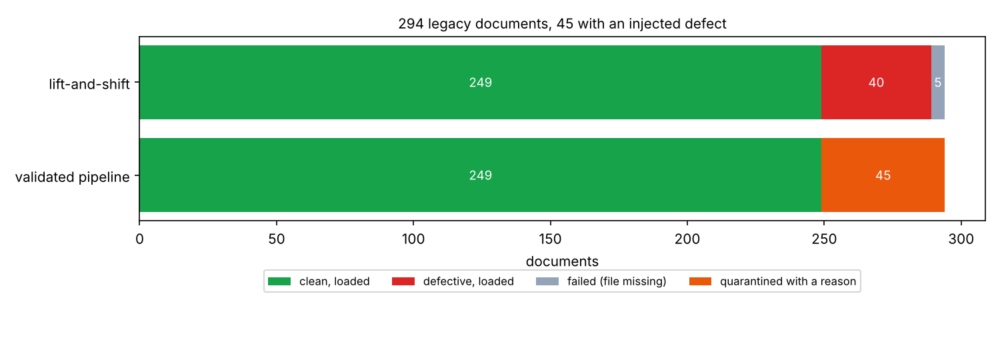
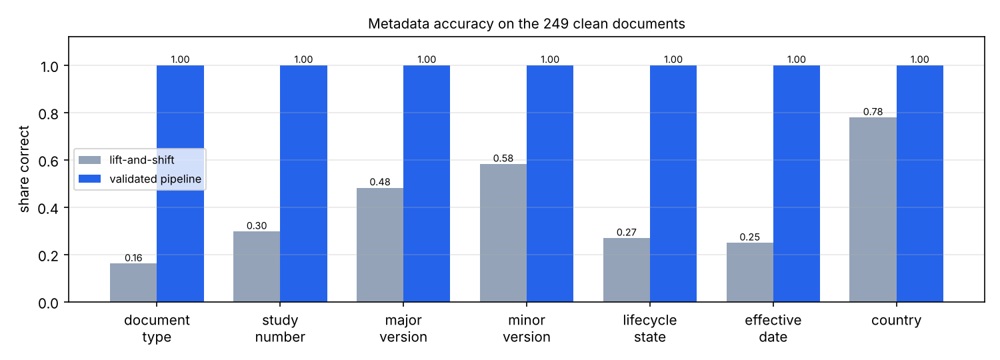

# 20 · GxP document migration and application retirement

🇸🇰 [Slovenská verzia](README.sk.md)

## TL;DR
- 294 legacy documents for 119 real (public) clinical trials, with messy metadata and **45 injected defects**
  (9 types × 5). The task: move them into a Vault-like DMS, then retire the legacy CTMS application.
- **Naive lift-and-shift loads 40 of the 45 defective documents, and 0 % of the clean records end up with fully
  correct metadata** (document type right in only 16.1 % of cases, dates in 24.9 %).
- **The validated pipeline quarantines all 45 with the right reason, rejects 0 of the 249 clean documents, and loads
  them with 100 % correct metadata.** Every document is reconciled, and all 249 stored files are re-hashed and verified.
- Each integrity control is tested by breaking something on purpose: an edited audit entry is found (the chain
  breaks exactly at entry 42), a corrupted file in the store is found, and a lost row in the archive is found.
- 13 user requirements (URS) → 12 automated tests → a generated traceability matrix: **13 / 13 verified**.

## Problem
Pharma R&D keeps moving documents between systems (file shares → Veeva Vault, one Vault to another) and retiring old
applications. In a GxP environment this isn't a copy job: the target is a system of record, so every document
must arrive complete, unchanged and with correct metadata, and you must be able to *prove* that afterwards
(computer system validation, CSV). This step builds a small but complete version of such a migration and measures
what the controls buy compared to a naive copy.

## Setup
- **Source:** a frozen snapshot of 119 completed Phase 3 trials from ClinicalTrials.gov (`source_snapshot/`).
  `gxpmig/source.py` turns them into 294 documents (protocol synopses, informed consent forms, CSR synopses) plus a
  metadata export typed by many hands: 3–4 spellings per document type, four date formats, versions like `v2.0`,
  `2` or `V2`, study numbers like `nct01234567` and `NCT 01234567`. It also builds a legacy CTMS database with
  3 tables (776 rows) to retire.
- **Injected defects (5 of each, seed 0):** unknown document type, invalid date, future date, unknown study, missing
  file, checksum mismatch (file corrupted after check-in), duplicate content, invalid version, missing title.
- **Target:** SQLite metadata with CHECK constraints plus a content-addressed file store (SHA-256), modelled on Vault
  concepts (document number, type, lifecycle state, major/minor version). It is not the Veeva API: a real Vault
  migration would load through Vault Loader or the REST API, but the validation, reconciliation and audit logic
  stay the same.
- **Hardware:** cloud Linux CPU. Python 3.12; dependencies are pydantic, httpx (snapshot only) and matplotlib.

## How it works
```
legacy CSV + files ─► transform (mapping/*.csv) ─► validate ─┬─► load ─► verify SHA-256 ─► audit entry
                                                              └─► quarantine + reason ─────► audit entry
                                              reconciliation: source = loaded + already loaded + quarantined
legacy_ctms.db ─► CSV + JSON schema + manifest (row counts, checksums, retain until 2051) ─► independent verify
```
- **No guessing** (`gxpmig/transform.py`). Values are mapped only through the approved tables in `mapping/`
  (configuration under change control). Dates are read only in the documented legacy formats: `04/03/2019` is
  4 March because the legacy convention is dd/mm/yyyy, not because a parser guessed it. Anything else goes to
  quarantine with an issue code a person can act on, because a wrong value in a system of record is worse than a
  missing one.
- **Checksums at both ends.** The legacy MD5 proves the file is the one that was checked in. The target uses
  SHA-256, because MD5 collisions can be manufactured, and re-reads every stored copy after writing it.
- **One transaction per document**: content verified → metadata row → audit entry, or nothing.
- **Hash-chained audit trail** (`gxpmig/audit.py`). Triggers make the table append-only. Every entry stores the hash
  of the previous one, so editing any past entry, even with the triggers dropped, breaks the chain from that point.
  This covers the "attributable, contemporaneous, original" part of ALCOA+ and the audit-trail expectation of
  21 CFR Part 11.
- **Dry run and idempotency.** A dry run produces the same exceptions report without touching the target, so the
  business can review it first. Re-running a batch skips what is already there, so a crash halfway is safe.
- **Application retirement** (`gxpmig/archive.py`). The database is exported read-only to CSV + JSON schema with a
  manifest (row counts, file SHA-256, an order-independent content hash per table, retention date = 25 years per
  EU Regulation 536/2014). `verify()` rebuilds every table from the CSVs alone, without needing the old app.
- **Validation evidence.** `docs/URS.md` lists 13 requirements with a risk level. Each test is tagged
  `@pytest.mark.req("URS-xx")`, a pytest hook records the outcomes, and `scripts/traceability.py` writes
  `docs/traceability.md`. CI regenerates the matrix and fails if the committed one is out of date.
- **Visual example:** the reconciliation chart below shows where every document ended up. The Racing Lab cars were
  not used because a document migration has no natural driving analogue.

## Results
| | Lift-and-shift | Validated pipeline |
|---|---|---|
| Documents loaded | 289 | 249 |
| Defective documents loaded | **40 / 45** | **0 / 45** |
| Defects quarantined with the right issue code | – | 45 / 45 |
| Clean documents wrongly rejected | – | 0 / 249 |
| Clean records with fully correct metadata | 0.0 % | 100.0 % |
| Reconciled (source = loaded + quarantined) | no check | yes |
| Stored files re-hashed and verified | no check | 249 / 249 |
| Throughput | – | 336.5 documents/s |



Per-field accuracy of lift-and-shift on the clean documents: document type 0.161, study number 0.297, major
version 0.482, minor version 0.582, lifecycle state 0.269, effective date 0.249, country 0.779.



**Integrity controls, each tested by breaking something on purpose:**

| Control | Attack / fault | Result |
|---|---|---|
| Append-only audit trail | `UPDATE` / `DELETE` an entry | blocked by trigger |
| Hash chain | drop the trigger, edit entry 42 | detected, first broken entry = 42 |
| Content verification | truncate one stored file | exactly that file reported |
| Idempotency | run the same batch again | 0 loaded, target unchanged |
| Dry run | compare with the real run | identical outcomes |
| Archive verification | 3 tables, 776 rows | verified from CSVs alone; an edited CSV is detected |

## Error analysis
- **100 % detection is expected here, not impressive.** The same code injected the defects and checks for them, so
  the number proves the controls work for *known* defect types. It says nothing about defects nobody anticipated.
  On a real migration the equivalent number comes from a trial migration of real data, followed by a business
  review of the exceptions report.
- **Lift-and-shift's 0 % fully-correct records** comes from format, not content. A human would read
  `nct 01234567` or `4 Mar 2019` correctly, but the target system and every report or search built on it can't.
  That is why normalisation belongs in the migration, not in later cleanup.
- **Lift-and-shift loses the 5 missing-file documents silently.** No reconciliation means nobody notices that
  289 ≠ 294.

## What I learned
- In a regulated migration the deliverable isn't moved data, it's *evidence*: reconciliation, checksums, an
  audit trail and a requirement → test → result matrix.
- Quarantine with a reason code beats "best effort" mapping. Every guess is a potential data-integrity finding.
- A hash chain makes an audit trail tamper-*evident*, not tamper-*proof*. Someone with full access can rewrite the
  whole chain, so the latest hash has to be anchored outside the database (it is printed in the run report).

## Run it
```bash
uv sync
make source       # legacy side from the committed snapshot (offline)
make dry-run      # exceptions report without touching the target → reports/B001-dry-run/
make migrate      # real run → data/vault/, reports/B001/
make archive      # retire the legacy CTMS → data/archive/
make experiment   # baseline vs pipeline + integrity controls → results.json
make plot         # → assets/*.png
make validate     # tests + docs/traceability.md
```

## Limitations
- Synthetic defects and plain-text documents. Real migrations also deal with PDFs and renditions, signatures,
  version histories, relationships between documents and access rights.
- The target imitates Vault concepts. No Veeva API is called (it is licensed software).
- One batch, single process. Large migrations run in parallel batches with a reconciliation per batch.
- The validation package is a minimal sketch (URS, OQ-style tests, traceability). A real CSV/CSA package also needs
  a validation plan, risk assessment, IQ/PQ and signed approvals.
