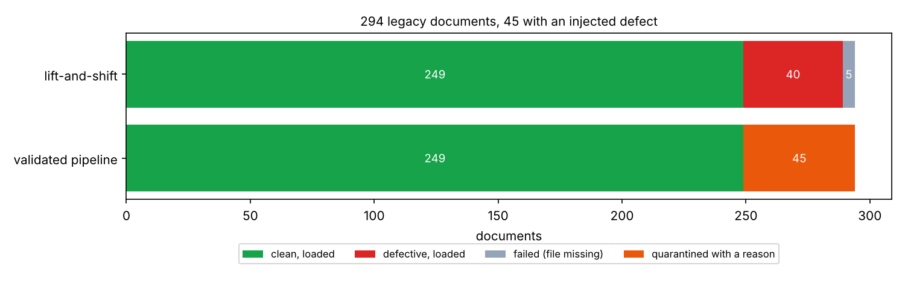
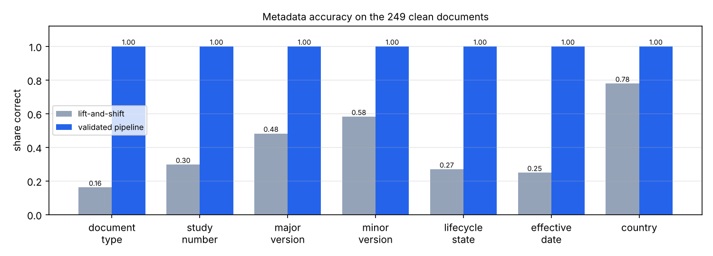

# 20 · GxP migrácia dokumentov a vyradenie aplikácie

🇬🇧 [English version](README.md)

## TL;DR
- 294 legacy dokumentov pre 119 skutočných (verejných) klinických štúdií s neporiadnymi metadátami a **45 zámerne
  vloženými chybami** (9 typov × 5). Úloha: presunúť ich do DMS podobného Vaultu a potom vyradiť starú CTMS
  aplikáciu.
- **Naivný lift-and-shift nahrá 40 zo 45 chybných dokumentov a 0 % správnych záznamov skončí s úplne správnymi
  metadátami** (typ dokumentu je správne iba v 16,1 % prípadov, dátumy v 24,9 %).
- **Validovaná pipeline dá všetkých 45 do karantény so správnym dôvodom, neodmietne ani jeden z 249 správnych
  dokumentov a nahrá ich so 100 % správnymi metadátami.** Každý dokument je zosúhlasený a všetkých 249 uložených
  súborov je znova prehashovaných a overených.
- Každá kontrola integrity je otestovaná tak, že niečo zámerne pokazím: upravený záznam v audit traile sa nájde
  (reťazec sa preruší presne na zázname 42), poškodený súbor v úložisku sa nájde a stratený riadok v archíve sa
  nájde.
- 13 používateľských požiadaviek (URS) → 12 automatických testov → vygenerovaná traceability matica:
  **13 / 13 overených**.

## Problém
Farmaceutické R&D neustále presúva dokumenty medzi systémami (zdieľané disky → Veeva Vault, jeden Vault do iného)
a vyraďuje staré aplikácie. V GxP prostredí to nie je obyčajné kopírovanie: cieľ je systém záznamov (system of
record), takže každý dokument musí doraziť úplný, nezmenený a so správnymi metadátami, a musí sa to dať neskôr
*dokázať* (validácia počítačových systémov, CSV). Tento krok stavia malú, ale úplnú verziu takej migrácie a meria,
čo kontroly prinesú oproti naivnému kopírovaniu.

## Setup
- **Zdroj:** zmrazený snapshot 119 ukončených štúdií fázy 3 z ClinicalTrials.gov (`source_snapshot/`).
  `gxpmig/source.py` z nich vytvorí 294 dokumentov (synopsy protokolov, informované súhlasy, synopsy CSR) a export
  metadát, ktorý písalo veľa ľudí: 3–4 zápisy pre každý typ dokumentu, štyri formáty dátumu, verzie ako `v2.0`,
  `2` alebo `V2`, čísla štúdií ako `nct01234567` a `NCT 01234567`. Vytvorí aj legacy CTMS databázu s 3 tabuľkami
  (776 riadkov) na vyradenie.
- **Vložené chyby (po 5 z každej, seed 0):** neznámy typ dokumentu, neplatný dátum, dátum v budúcnosti, neznáma
  štúdia, chýbajúci súbor, nesúhlasiaci checksum (súbor poškodený po uložení), duplicitný obsah, neplatná verzia,
  chýbajúci názov.
- **Cieľ:** SQLite metadáta s CHECK obmedzeniami a úložisko súborov adresované obsahom (SHA-256), podľa konceptov
  Vaultu (číslo dokumentu, typ, stav životného cyklu, hlavná/vedľajšia verzia). Nie je to Veeva API: skutočná
  migrácia do Vaultu by nahrávala cez Vault Loader alebo REST API, ale logika validácie, zosúhlasenia a auditu je
  rovnaká.
- **Hardvér:** cloudové Linux CPU. Python 3.12; závislosti sú pydantic, httpx (iba pre snapshot) a matplotlib.

## Ako to funguje
```
legacy CSV + súbory ─► transform (mapping/*.csv) ─► validácia ─┬─► load ─► overenie SHA-256 ─► záznam v audite
                                                                └─► karanténa + dôvod ───────► záznam v audite
                                         zosúhlasenie: zdroj = nahrané + už nahrané + v karanténe
legacy_ctms.db ─► CSV + JSON schéma + manifest (počty riadkov, checksumy, uchovať do 2051) ─► nezávislé overenie
```
- **Žiadne hádanie** (`gxpmig/transform.py`). Hodnoty sa mapujú iba cez schválené tabuľky v `mapping/`
  (konfigurácia pod change controlom). Dátumy sa čítajú iba v zdokumentovaných legacy formátoch: `04/03/2019` je
  4. marec, lebo legacy konvencia je dd/mm/rrrr, nie preto, že by to parser uhádol. Všetko ostatné ide do karantény
  s kódom problému, podľa ktorého vie človek konať, lebo nesprávna hodnota v systéme záznamov je horšia ako
  chýbajúca.
- **Checksumy na oboch koncoch.** Legacy MD5 dokazuje, že súbor je ten, ktorý bol uložený. Cieľ používa SHA-256,
  lebo kolízie MD5 sa dajú vyrobiť, a každú uloženú kópiu po zápise znova prečíta.
- **Jedna transakcia na dokument**: overený obsah → riadok metadát → záznam v audite, alebo nič.
- **Audit trail s hash reťazcom** (`gxpmig/audit.py`). Triggery robia tabuľku iba na pridávanie. Každý záznam
  ukladá hash predchádzajúceho, takže úprava hocktorého starého záznamu, aj s vypnutými triggermi, preruší reťazec
  od toho miesta. To pokrýva časť „attributable, contemporaneous, original“ z ALCOA+ a očakávania na audit trail
  z 21 CFR Part 11.
- **Dry run a idempotencia.** Dry run vytvorí rovnaký report výnimiek bez zásahu do cieľa, takže ho biznis môže
  najprv skontrolovať. Opakovaný beh dávky preskočí, čo už je nahrané, takže pád v polovici je bezpečný.
- **Vyradenie aplikácie** (`gxpmig/archive.py`). Databáza sa exportuje iba na čítanie do CSV + JSON schémy
  s manifestom (počty riadkov, SHA-256 súborov, hash obsahu každej tabuľky nezávislý od poradia, dátum uchovania
  = 25 rokov podľa nariadenia EÚ 536/2014). `verify()` poskladá každú tabuľku iba z CSV, bez potreby starej
  aplikácie.
- **Validačné dôkazy.** `docs/URS.md` obsahuje 13 požiadaviek s úrovňou rizika. Každý test je označený
  `@pytest.mark.req("URS-xx")`, pytest hook zapíše výsledky a `scripts/traceability.py` vytvorí
  `docs/traceability.md`. CI maticu pregeneruje a zlyhá, ak je commitnutá verzia zastaraná.
- **Vizuálny príklad:** graf zosúhlasenia nižšie ukazuje, kde skončil každý dokument. Autíčka z Racing Labu som
  nepoužil, lebo migrácia dokumentov nemá prirodzenú analógiu v jazdení.

## Výsledky
| | Lift-and-shift | Validovaná pipeline |
|---|---|---|
| Nahrané dokumenty | 289 | 249 |
| Nahrané chybné dokumenty | **40 / 45** | **0 / 45** |
| Chyby v karanténe so správnym kódom | – | 45 / 45 |
| Nesprávne odmietnuté správne dokumenty | – | 0 / 249 |
| Správne záznamy s úplne správnymi metadátami | 0,0 % | 100,0 % |
| Zosúhlasené (zdroj = nahrané + karanténa) | bez kontroly | áno |
| Uložené súbory znova prehashované a overené | bez kontroly | 249 / 249 |
| Priepustnosť | – | 336,5 dokumentu/s |



Presnosť jednotlivých polí pri lift-and-shift na správnych dokumentoch: typ dokumentu 0,161, číslo štúdie 0,297,
hlavná verzia 0,482, vedľajšia verzia 0,582, stav životného cyklu 0,269, dátum účinnosti 0,249, krajina 0,779.



**Kontroly integrity, každá otestovaná tak, že niečo zámerne pokazím:**

| Kontrola | Útok / porucha | Výsledok |
|---|---|---|
| Audit trail iba na pridávanie | `UPDATE` / `DELETE` záznamu | zablokované triggerom |
| Hash reťazec | vypnúť trigger, upraviť záznam 42 | odhalené, prvý porušený záznam = 42 |
| Overenie obsahu | skrátiť jeden uložený súbor | nahlásený presne ten súbor |
| Idempotencia | spustiť tú istú dávku znova | 0 nahraných, cieľ nezmenený |
| Dry run | porovnať so skutočným behom | rovnaké výsledky |
| Overenie archívu | 3 tabuľky, 776 riadkov | overené iba z CSV; upravené CSV sa odhalí |

## Analýza chýb
- **100 % odhalenie je tu očakávané, nie pôsobivé.** Ten istý kód chyby vložil aj ich kontroluje, takže číslo
  dokazuje, že kontroly fungujú pre *známe* typy chýb. Nehovorí nič o chybách, ktoré nikto nepredvídal. Pri
  skutočnej migrácii prichádza ekvivalentné číslo zo skúšobnej migrácie reálnych dát a následnej biznis kontroly
  reportu výnimiek.
- **0 % úplne správnych záznamov pri lift-and-shift** spôsobuje formát, nie obsah. Človek by `nct 01234567` alebo
  `4 Mar 2019` prečítal správne, ale cieľový systém ani reporty a vyhľadávanie nad ním nie. Preto normalizácia
  patrí do migrácie, nie do neskoršieho upratovania.
- **Lift-and-shift potichu stratí 5 dokumentov s chýbajúcim súborom.** Bez zosúhlasenia si nikto nevšimne, že
  289 ≠ 294.

## Čo som sa naučil
- Pri regulovanej migrácii nie je výstupom presunuté dáta, ale *dôkazy*: zosúhlasenie, checksumy, audit trail
  a matica požiadavka → test → výsledok.
- Karanténa s kódom dôvodu je lepšia ako mapovanie „najlepšie, ako sa dá“. Každý odhad je potenciálny nález
  v oblasti integrity dát.
- Hash reťazec robí audit trail *odhaliteľným* pri zmene, nie *nezmeniteľným*. Kto má plný prístup, vie prepísať
  celý reťazec, preto treba posledný hash uložiť mimo databázy (je vypísaný v reporte behu).

## Spustenie
```bash
uv sync
make source       # legacy strana zo commitnutého snapshotu (offline)
make dry-run      # report výnimiek bez zásahu do cieľa → reports/B001-dry-run/
make migrate      # skutočný beh → data/vault/, reports/B001/
make archive      # vyradenie legacy CTMS → data/archive/
make experiment   # baseline vs pipeline + kontroly integrity → results.json
make plot         # → assets/*.png
make validate     # testy + docs/traceability.md
```

## Obmedzenia
- Syntetické chyby a čisto textové dokumenty. Skutočné migrácie riešia aj PDF a rendition, podpisy, históriu verzií,
  vzťahy medzi dokumentmi a prístupové práva.
- Cieľ napodobňuje koncepty Vaultu. Žiadne Veeva API sa nevolá (je to licencovaný softvér).
- Jedna dávka, jeden proces. Veľké migrácie bežia v paralelných dávkach so zosúhlasením pre každú dávku.
- Validačný balík je minimálny náčrt (URS, testy v štýle OQ, traceability). Skutočný CSV/CSA balík potrebuje aj
  validačný plán, hodnotenie rizík, IQ/PQ a podpísané schválenia.
